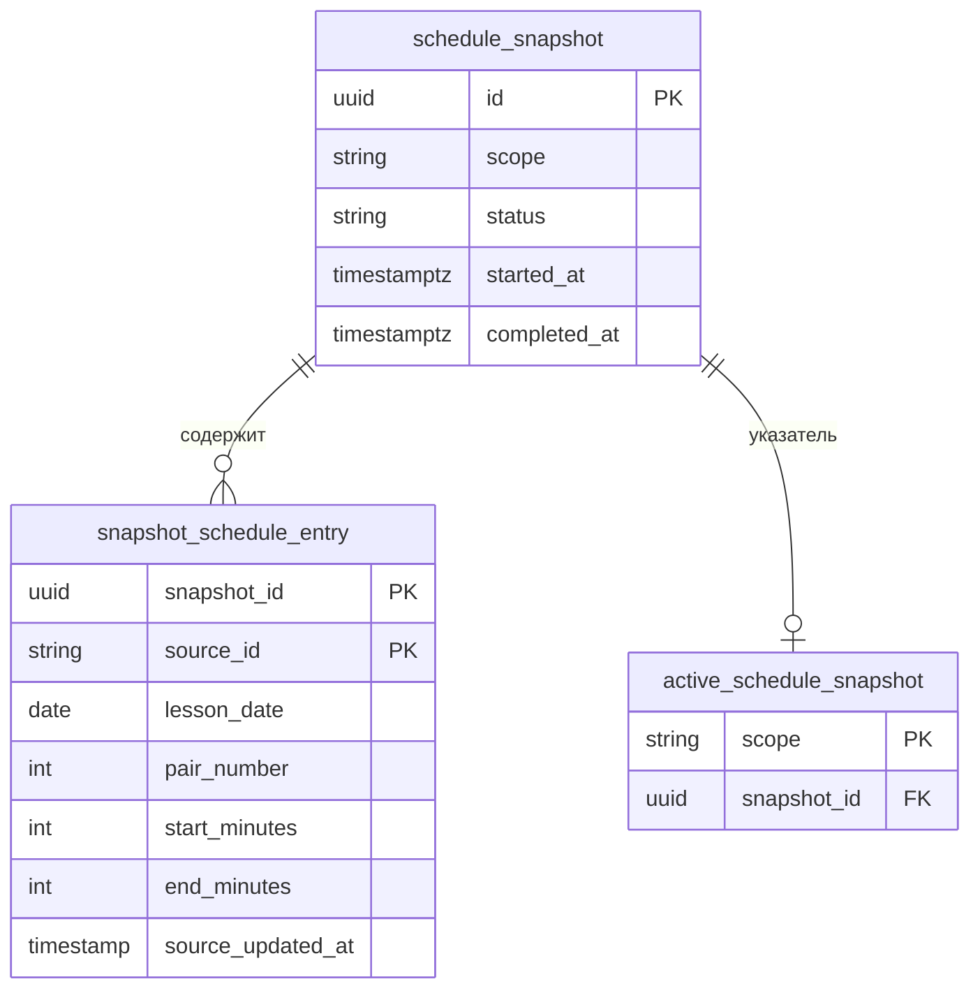
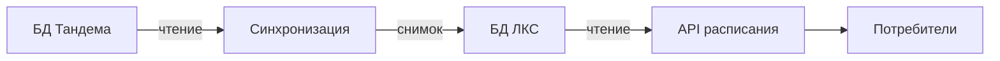
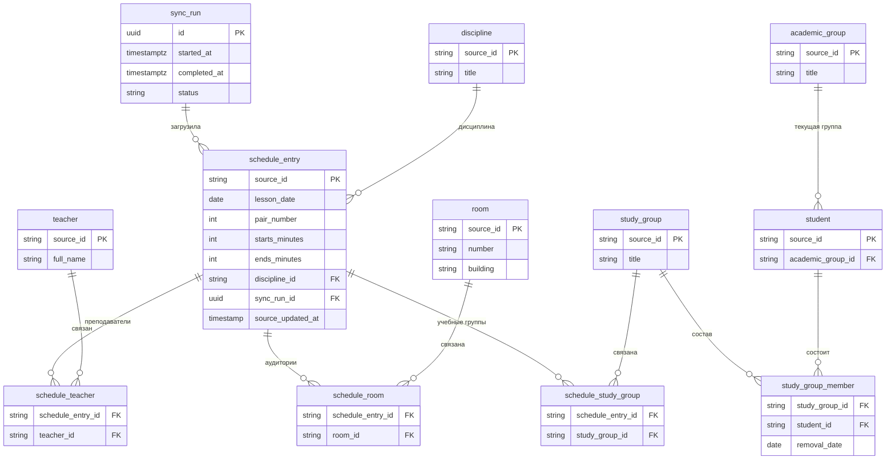

# ЛКС: локальный снимок расписания — проект

Статус: проект для согласования по итогам созвона 27.11.2026. Актуальное поручение: получать расписание из Тандема в БД ЛКС, API читает из БД ЛКС. Редактирование источника Тандема и запись в него SQL не предусмотрены. ADR 0002 предлагал выбор реплики или снимка; решение о снимке уточняет прежнюю альтернативу.

## Реализованная основа

Подготовлены модели `schedule_snapshot`, `snapshot_schedule_entry` и `active_schedule_snapshot` и миграция `20261127_01`. Миграция ещё не применялась к PostgreSQL. Записи одной и той же пары могут существовать в нескольких снимках: ключ занятия — `(snapshot_id, source_id)`. Активный снимок выбирается отдельно для каждой области; составной внешний ключ не позволяет указать снимок другой области.

Миграция `20261127_02` добавляет таблицы `schedule_group`, `schedule_room`, `schedule_teacher`, `schedule_discipline`. Они пока не применены к PostgreSQL, не заполнены автоматически и не связаны с занятиями. Идентификаторы и поля хранятся по текущему интерфейсу чтения SQL, сопоставление с НСИ ещё не подтверждено.

Добавлен первый вариант загрузки одной ограниченной выборки и атомарного переключения её указателя в транзакции БД ЛКС. Область временно определяется точным сочетанием фильтра, ID и дат; пересекающиеся области автоматически не объединяются. Загрузка справочников, планировщик и чтение API не реализованы. Указатель БД сам по себе не запрещает активацию снимка со статусом `loading` или `failed`: сервис переключает только созданный им готовый снимок.

Внутренняя функция чтения получает только готовый активный снимок точной области и различает отсутствие снимка и сохранённый пустой снимок. К HTTP API она пока не подключена.

## Общая схема

## Предлагаемые таблицы

Это целевая схема слоя расписания и связанных справочников, а не всех таблиц ЛКС; она пока не реализована. Имя `sync_run` ниже показывает логическую роль реализованной таблицы `schedule_snapshot`; структура записей отличается от текущей модели. ID источника сохраняем без изменения как строки; формат внешнего API нужно согласовать с командой. Студенты и участие в учебных группах показаны отдельно: академическая группа и учебная группа Тандема — разные сущности.

Таблицы связей должны иметь составные уникальные ключи. `source_updated_at` в Тандеме имеет тип timestamp без часового пояса: не присваивать UTC без подтверждения. Для корректной истории переводов текущей академической группы недостаточно — нужна проверенная история членства. Чётность, отмены, актуальность версий, состав данных и правила правок подлежат уточнению; значения по умолчанию не должны выдавать неизвестное за подтверждённое.

## Синхронизация — предлагаемый подход

1. Чтение ограниченными выборками с read-only доступом. Выгрузка без фильтра по группе/преподавателю и периоду запрещена действующим ТЗ; для фоновой загрузки всех необходимых данных нужно согласовать отдельную стратегию и бюджет с владельцем Тандема.
2. Запись в отдельный набор данных ЛКС с отметкой запуска синхронизации. Повторная загрузка того же ID не должна создавать дубликаты.
3. После успешной загрузки всех страниц и связей область данных переключается атомарно. Ошибка не удаляет предыдущий рабочий снимок.
4. Исчезновение из частичной выборки не означает удаление; отмены, переносы и удаление обрабатывать только по согласованному правилу полной выборки конкретной области.
5. Фиксировать время последнего успешного обновления и ошибки, различать пустой результат и ошибку источника.

Реализован только первый вариант полной выборки одной области: если источник вернул 200 строк, сервис отклоняет результат, так как страниц пока нет. При ошибке чтения или записи прежний активный снимок сохраняется; запись и переключение выполняются одной транзакцией. Первая одновременная загрузка одной области может завершиться конфликтом уникальности, и повтор пока не реализован. История неудачных попыток не сохраняется. Требуется определить периодичность, области загрузки, маркер изменений, способ обработки удалений и прав доступа; `sysupdatedate_p` занятия может не отражать изменения связанных сущностей. Проверка на PostgreSQL и подключение к API ещё нужны.

## Открытые решения

- Какую среду и учётную запись использовать для чтения источника, какие данные допустимо хранить локально и сколько времени?
- Получать данные опросом БД, через НСИ или сочетанием? Подтвердить правила и лимиты для фоновой синхронизации.
- Как трактовать основную версию с NULL-датами, отмены и историю состава групп?
- bigint, guid_p или оба идентификатора в публичном контракте? Как передавать их в функции коллег?
- Нужны ли в первом этапе студенты и персональные данные для персонального расписания? Если да, определить минимальные поля и разграничение доступа.
- Какой набор API требуется показать и кто отвечает за журнал и ведомости? В `docs/api_inventory_snapshot.md` приведены операции текущего OpenAPI; существование контракта не означает реализацию.
